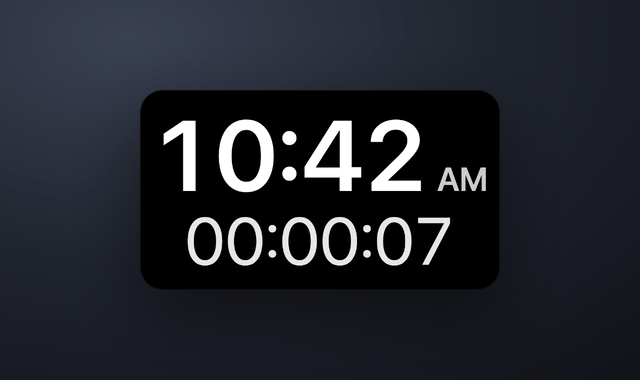

# Overtime ⏱

**Overtime** is a tiny always-on-top desktop widget that shows the current time *and* a stopwatch for how long you've been recording. It floats over whatever you're capturing so you — and your viewers — can watch the minutes burn, because the "10-minute" screencast always runs long. Frameless, transparent, stays on top, and gets out of the way until you need it.



> Built on camera with Claude Code for the [BakerCode](https://www.youtube.com/@bakercode) YouTube series, then set loose as its own little app.

---

## Install

### Just want to use it? (most people)

Prebuilt, ready-to-run apps (macOS Apple Silicon + Intel, and Windows) live in the companion **[overtime-releases](https://github.com/jbaker-code/overtime-releases)** repo — no installer, nothing to set up. Grab the one zip for your machine, then:

- **macOS** — unzip, drop `Overtime.app` wherever you like, double-click. It's **unsigned**, so the first time: right-click → **Open** (or System Settings → Privacy & Security → **Open Anyway**).
- **Windows** — unzip the folder fully, run `Overtime.exe`. SmartScreen may warn about an unknown publisher: **More info → Run anyway**.

Overtime lives in your **menu bar / system tray** (no Dock or taskbar clutter) — right-click the pill or use the menu-bar icon for Start/Pause/Reset, show/hide each readout, settings, and quit. Full walkthrough in **[docs/GUIDE.md](docs/GUIDE.md)**.

### Want to build or hack on it? (developers)

```bash
git clone https://github.com/jbaker-code/overtime.git
cd overtime
npm install
npm start          # run the widget locally (Electron)
```

Build commands (outputs land in a dated `tmp/overtime-build-…/dist/` folder):

| Command | What it builds |
|---|---|
| `npm run build` | **everything** — macOS (arm64 + x64), Windows, single-file HTML, and a source zip |
| `npm run build:mac` | macOS `.app` zips (unsigned, `dir` target — no installer) |
| `npm run build:win` | Windows app folder, zipped (cross-built from macOS, no installer) |
| `npm run build:single` | the self-contained single-file `index.html` |
| `npm run build:source` | a source zip |
| `npm test` | the Playwright suite (unit + single-file in headless Chromium + the real Electron app) |
| `npm run clean` | wipe the build temp + scratch |

Architecture, the build pipeline, and how it's all wired live in **[docs/GUIDE.md](docs/GUIDE.md)** and **[ARCHITECTURE.md](docs/ARCHITECTURE.md)**; the rationale behind every non-obvious engineering choice (the cutout canvas, the cursor-poll hover, the separate settings window…) is in **[docs/dev/TECHNICAL.md](docs/dev/TECHNICAL.md)**.

---

## What it does

- **Wall clock** (`HH:MM` + AM/PM, or 24-hour) and an **episode stopwatch** (`HH:MM:SS`) with Play / Pause / Reset.
- **Always-on-top, frameless, transparent** — a rounded pill that floats over your recording and is captured fine by OBS.
- **Hover for controls**, drag anywhere to move, resize freely — the readouts scale to fill whatever size you pick.
- **Make it yours**: 10 layouts, 9 curated fonts *plus* a system-font browser (pick any font installed on your machine), and background/text colors from 9 quick-pick swatches each *or* any color you like via the built-in color picker. Two opacity sliders (pill and text), a **Cutout** mode that punches the numerals clean through the pill to your desktop, and tray toggles to show/hide either readout (turn both off for a blank pill). It remembers everything between launches.

---

## Credits & license

- **Author:** Claude (Anthropic) — written on camera with [Claude Code](https://claude.com/claude-code).
- **Ideas guy / direction:** Jason Baker · <jason@bakercode.org> · [BakerCode](https://www.youtube.com/@bakercode)
- **License:** [MIT](LICENSE) — do what you like, just keep the notice.
- **Home:** https://github.com/jbaker-code/overtime
